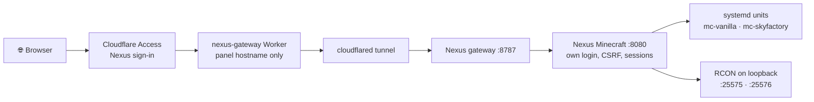

<div align="center">


# Nexus Minecraft

**A private control room for your Minecraft servers.**<br>
Status, live console, players, files, backups and host health for existing systemd Minecraft services, in a React panel with a FastAPI backend. Part of the [Nexus](https://github.com/ljcatherine/Nexus) ecosystem.

[](frontend)
[](panel)
[](deploy)
[](docs/CLOUDFLARE.md)
[](https://github.com/ljcatherine/Nexus)

[Install](#install) ·
[Publish with Cloudflare](docs/CLOUDFLARE.md) ·
[Security](docs/SECURITY.md) ·
[Recovery](docs/RECOVERY.md) ·
[Limitations](docs/LIMITATIONS.md) ·
[Setup guide](https://nexus.liamjc.dev/docs/apps/minecraft/)

</div>

---

## What it does

| | Page | What you get |
|---|---|---|
| 🏠 | **Dashboard** | Every server at a glance: state, players online, memory, CPU and uptime, plus live host CPU and memory charts. |
| 🖥️ | **Servers** | Start, stop and restart through the existing systemd units, with confirmation before players are disconnected. |
| ⌨️ | **Console** | Live journal output with search and severity filters, and commands sent over private loopback RCON. |
| 👥 | **Players** | Who's online, whitelist, ops and bans, each action confirmed. |
| 📁 | **Files** | Browse and edit server files with revision checks, path confinement and syntax preview for JSON, YAML and properties. |
| 🗄️ | **Backups** | Your existing nightly maintenance sets, inspection and logs. No second backup scheduler. |
| 🧩 | **Extensions** | Installed plugins or Forge mods, and trusted JAR uploads. |
| 🩺 | **Diagnostics** | Read-only checks of units, paths, permissions and RCON reachability. |
| 🔑 | **Accounts** | Named admin and viewer accounts, private single-use invitations, and an audit log of every change. |

The existing systemd services stay the source of truth. The panel never replaces your server units, worlds or backup timer, and it never shows made-up statistics: anything it can't measure reads "Unavailable".

## How it's reached



The panel binds to loopback and has its own login, but it's never exposed directly. It's published on its own hostname through the [Nexus gateway and Worker](https://github.com/ljcatherine/NexusBackend), behind Cloudflare Access, so a visitor must pass Access, the Worker's owner check, the gateway's verification and then the panel's own sign-in. See [Publish with Cloudflare](docs/CLOUDFLARE.md).

## Install

> [!NOTE]
> Requires Debian 12 or newer with Python 3.11+, existing Minecraft systemd units, and Node.js 20.19+ on the build machine only. The service, account and paths keep their original `ps5-panel` names (`ps5-panel.service`, `/opt/ps5-server-panel`, `/etc/ps5-panel`) so existing installs update in place.

**Build a release** on your computer:

```sh
npm ci --prefix frontend && npm run build --prefix frontend
tar -czf release.tar.gz panel deploy frontend/dist requirements.txt requirements.lock.txt config.example.json README.md docs tests
```

**Install** on the server: copy the release over, extract it into its own directory, review `deploy/install.sh`, then run it.

```sh
sudo bash deploy/install.sh
```

The installer creates a dedicated account, a root-owned copy of the code, a narrowly scoped root helper and ACLs, and starts the panel. It adds a firewall dependency to the Minecraft units without changing their `ExecStart` or worlds, and it never restarts Minecraft during installation. From Windows, `deploy/deploy.ps1 -HostName <server> -User <account>` does the build, copy and install in one step.

**Create your account** (it prompts for a password of at least 12 characters):

```sh
cd /opt/ps5-server-panel
sudo -u ps5-panel .venv/bin/python -m panel.cli user <name>
```

**Set up RCON** with `sudo .venv/bin/python deploy/configure-rcon.py`. It installs the loopback firewall first, warns players, then restarts servers that were running. Credentials never reach the UI, the audit log or the command line.

## Configuration

`/etc/ps5-panel/config.json` is root-owned and readable only by the panel group; [`config.example.json`](config.example.json) shows every field. Keep `origin` identical to the address the browser uses, `bind` on `127.0.0.1` and `secure_cookie` on behind HTTPS.

## Update

```sh
sudo bash deploy/update-panel.sh
```

It snapshots the installed code and assets, copies the new release, restarts the panel and rolls back automatically if the panel doesn't come up.

## Development

```sh
python -m venv .venv
.venv/bin/python -m pip install -r requirements.lock.txt
.venv/bin/python -m pytest -q
npm ci --prefix frontend && npm run build --prefix frontend
```

Point `PS5_PANEL_CONFIG` at a private development config with local directories, `origin` `http://127.0.0.1:8080` and `bind` `127.0.0.1`, create a user with `python -m panel.cli user admin --config <file>`, then run `python -m panel.serve`. On Windows, Linux system operations report "Unavailable" instead of faking data.

## Security

> [!CAUTION]
> Never forward the panel, RCON or Minecraft management ports to the internet. Publish the panel only through Cloudflare Access or a VPN.

Sessions, CSRF tokens and the audit log live in SQLite. State-changing requests need a matching origin and CSRF token, file operations are confined to each server's root, and privileged actions go through a helper that hard-codes the allowed units. The [security folder](security) holds the threat model, audits and test results; [docs/SECURITY.md](docs/SECURITY.md) summarises the boundaries.

## The Nexus ecosystem

| Repository | What it is |
|---|---|
| [**Nexus**](https://github.com/ljcatherine/Nexus) | Overview, architecture and setup guides |
| [**NexusiOS**](https://github.com/ljcatherine/NexusiOS) | iPhone and iPad app |
| [**NexusNix**](https://github.com/ljcatherine/NexusNix) · [**NexusWindows**](https://github.com/ljcatherine/NexusWindows) | Nexus Desktop for Linux and Windows |
| [**NexusOnline**](https://github.com/ljcatherine/NexusOnline) | Web client at [nexus.liamjc.dev](https://nexus.liamjc.dev) |
| [**NexusBackend**](https://github.com/ljcatherine/NexusBackend) | Gateway, Worker, orchestrator and sign-in |
| [**NexusAI**](https://github.com/ljcatherine/NexusAI) | Local models on a PS5 |
| **NexusMinecraft** (this repo) | Minecraft server control panel |

<div align="center">
<sub>Nexus · by <a href="https://liamjc.dev">Liam Catherine</a> · <a href="https://nexus.liamjc.dev">nexus.liamjc.dev</a></sub>
</div>
